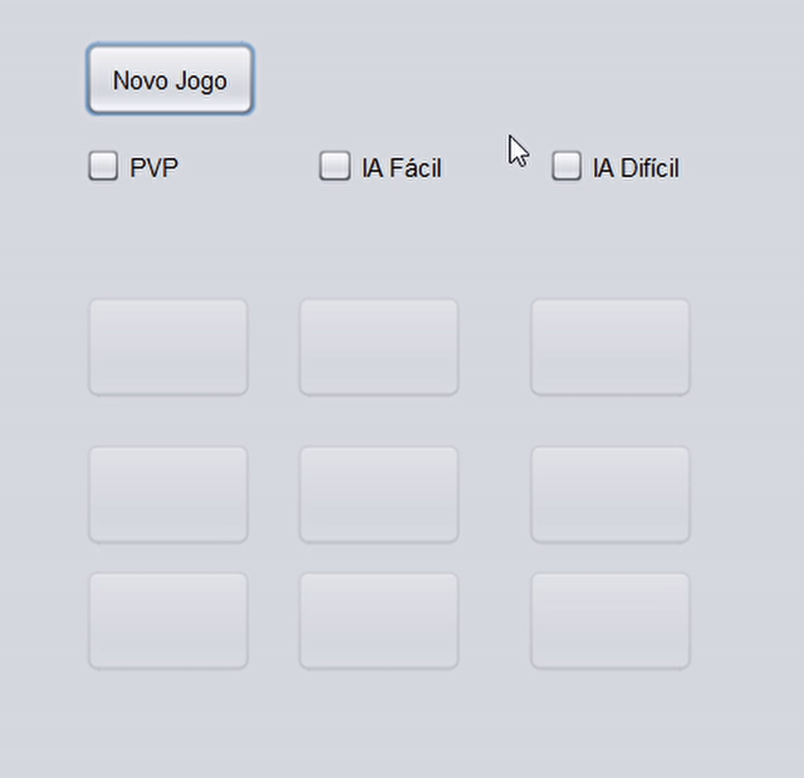

# Jogo da Velha com IA (Minimax)



Jogo da velha em **Java** com interface gráfica em **Swing**, três modos de jogo e uma IA difícil que usa o algoritmo **minimax**.

O projeto começou como um trabalho da escola e evoluiu para um estudo sobre como construir a melhor IA possível para o jogo, o que levou à descoberta do minimax.

## Modos de jogo

| Modo | Como funciona |
|---|---|
| **PVP** | Dois jogadores no mesmo computador, alternando entre `X` e `O` (o `X` começa) |
| **IA Fácil** | Você joga com `X` e a IA responde com `O` em uma casa livre escolhida aleatoriamente |
| **IA Difícil** | Você joga com `X` e a IA responde com `O` usando minimax, escolhendo sempre a melhor jogada |

Para jogar, escolha um modo e clique em **Novo Jogo**. Ao fim da partida (vitória ou empate), uma mensagem é exibida e a tela volta ao estado inicial para um novo jogo.

## Como a IA difícil funciona

A IA difícil usa **minimax**, um algoritmo de decisão para jogos de dois jogadores com turnos alternados. Para cada casa livre, ela simula a jogada e todas as continuações possíveis até o fim da partida, supondo que o adversário também joga da melhor forma:

- vitória da IA vale **+1**;
- vitória do jogador vale **-1**;
- empate vale **0**.

Nas jogadas da IA, o algoritmo escolhe o maior valor; nas do adversário, assume o menor. A IA joga na casa com o melhor resultado. Como o tabuleiro 3x3 tem poucas posições, a busca completa roda instantaneamente, e o resultado é uma IA que não perde.

## Organização do código

```
├── src/Telas/
│   ├── Principal.java   # tela Swing, regras do jogo e IA (fácil e minimax)
│   ├── Posicao.java     # posição no tabuleiro (linha e coluna)
│   └── Principal.form   # layout da tela, editado pelo NetBeans
├── nbproject/           # configuração do projeto NetBeans
├── build.xml
└── manifest.mf
```

O tabuleiro é uma matriz 3x3 de texto, e a lógica foi organizada em métodos pequenos e com nomes claros (por exemplo `turnoJogador`, `turnoIA`, `verificaGanhador`, `jogadasPossiveis`), resultado de refatorações com **Clean Code** e **Object Calisthenics**. Hoje a interface, as regras e a IA ainda ficam na mesma classe, o que motiva o próximo passo do projeto.

## Tecnologias

- Java (configurado para JDK 24)
- Java Swing
- NetBeans (projeto Ant)

## Como executar

### Pré-requisitos

- JDK 24 ou superior
- NetBeans: a tela usa a biblioteca de layout absoluto (*Absolute Layout*) do próprio IDE, por isso o projeto deve ser aberto no NetBeans

### Passos

1. Clone o repositório:
   ```bash
   git clone https://github.com/NicolasPPeixoto/jogo-da-velha-minimax.git
   ```
2. No NetBeans, abra o projeto em **File → Open Project**.
3. Execute com **Run Project** (F6). A classe principal é `Telas.Principal`.

Para gerar o JAR, use **Clean and Build**; o arquivo `JogoDaVelha.jar` é criado na pasta `dist/`.

## Próximos passos

- [ ] Migrar para a arquitetura **MVC**, separando o modelo (tabuleiro e regras), a IA e a tela, para desacoplar ainda mais o código. Esta migração está em andamento.

## Autor

Nícolas Pietro Peixoto: [GitHub](https://github.com/NicolasPPeixoto) · [LinkedIn](https://www.linkedin.com/in/nicolas-peixoto-/)
